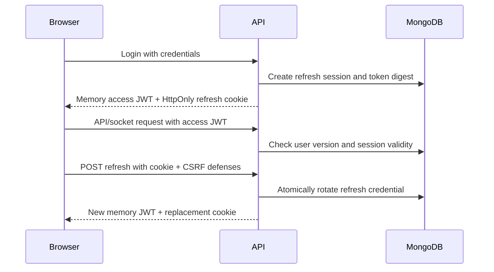

# Token Lifecycle Design Review

Status: proposed for review, not implemented. This document does not change the
current seven-day JWT, browser storage, or deployment configuration.

## Current System

- `server/src/utils/sessionTokens.js` issues seven-day JWTs containing user ID and
  session version. There is no refresh endpoint or refresh-session model.
- `client/src/context/AuthContext.jsx` persists tokens in localStorage and uses
  storage events to synchronize tabs. `api.js` sends bearer Authorization headers;
  it does not currently include cross-origin cookies.
- REST and sockets check account session versions. Password changes and log out
  everywhere invalidate old generations. Sockets also enforce token expiry.
- Ordinary logout clears browser state but does not revoke the token server-side.
- CORS permits configured browser origins with credentials, but cookie-specific
  CSRF defenses and refresh coordination do not exist yet.
- README names Vercel and Render as intended hosts. A production domain layout
  has not been selected in the repository configuration.

## Options

| Approach | Benefits | Tradeoffs |
| --- | --- | --- |
| Keep seven-day JWT in localStorage | Least code; current REST/socket flow works | Long-lived credential accessible to page JavaScript; no silent renewal |
| Memory access JWT + HttpOnly refresh cookie | Retains bearer REST/socket transport; removes persisted JS-readable credentials; short access lifetime | Rotation, CSRF, cross-tab coordination, and refresh-session storage add complexity |
| Opaque server session in an HttpOnly cookie | Simpler single-session model; no browser access JWT or refresh rotation | Moves REST/socket authentication to cookies; requires CSRF and handshake-origin protection throughout |

Opaque cookie sessions are a valid, potentially simpler design for a browser-only
application. Keeping JWT is not inherently more secure. The hybrid option is the
recommended incremental fit for this project's existing bearer API and Socket.IO
handshake, and its explicit JWT learning goal.

OWASP advises against keeping credentials in Web Storage because page scripts can
read them. HttpOnly reduces direct cookie theft by scripts; it does not prevent
XSS from making authenticated requests or accessing a new access token returned
to JavaScript. XSS defenses remain necessary.
[OWASP session guidance](https://cheatsheetseries.owasp.org/cheatsheets/Session_Management_Cheat_Sheet.html#html5-web-storage-api)

## Recommended Defaults

These are project choices to approve, not universal security requirements:

- Access JWT: 15 minutes, held only in memory, sent through Authorization and
  Socket.IO's existing auth payload. Never persist in Web Storage or URLs.
- Refresh session: seven-day absolute lifetime from login, not extended by
  rotation. This keeps the current maximum login duration rather than silently
  introducing a longer remembered-login period. No remember-me option initially.
- Refresh credential: opaque, cryptographically random 256-bit secret plus a
  public session selector; stored only in an HttpOnly cookie. Store a SHA-256
  digest of the full credential in MongoDB, not the raw secret. Passwords continue
  using their existing password hashing; random tokens do not need bcrypt.
- Add `sid` (refresh-session/family ID) to access tokens. Pin the allowed signing
  algorithm and validate access-token issuer, audience, purpose, expiry, user ID,
  account version, and session ID. Do not accept GitHub OAuth state as app auth.
- Keep account-wide `sessionVersion` checks. Also check session-family validity
  for REST and sockets so ordinary logout and replay detection can revoke that
  browser session's existing access tokens immediately.

## Cookie and Deployment Contract

Preferred production layout: frontend and API on HTTPS subdomains of a domain
the user controls, or a single origin through a proxy that also supports
Socket.IO. `app.example.com` / `api.example.com` are examples, not configured hosts.

Proposed API cookie: `__Host-sdlcflow_refresh`, HttpOnly, Secure, SameSite=Strict,
Path=/, no Domain attribute. Cookie lifetime must not exceed the session's
remaining absolute lifetime. Clear it with matching name/path settings.
The host prefix requires Secure, Path=/, and no Domain attribute.
[MDN cookie attributes](https://developer.mozilla.org/en-US/docs/Web/HTTP/Reference/Headers/Set-Cookie)

Same-site subdomains are still different origins: refresh requests need
`credentials: 'include'`, and CORS must allow only the exact frontend origin with
credentials. Cookies are not scoped by port. For local development, consistently
use localhost for both apps, or consistently use 127.0.0.1; do not mix them. Use
an explicitly development-only non-prefixed, non-Secure cookie for HTTP testing,
and refuse that configuration in production. Test production flags over HTTPS.

The default Vercel/Render hostnames would be cross-site. SameSite=None; Secure
would be necessary there, but would not override browsers' third-party-cookie
restrictions. Do not make that the default launch design or silently fall back
to storing a refresh token in localStorage.
[MDN third-party cookie guidance](https://developer.mozilla.org/en-US/docs/Web/Privacy/Guides/Third-party_cookies)

**Deployment gate:** choose same-site custom hostnames or a suitable shared-origin
proxy before enabling this flow in production. No domain purchase or hosting
change is part of this review.

## CSRF and Endpoint Contract

All cookie-setting or cookie-authenticated mutations (login, registration,
refresh, logout) must validate an exact allowed Origin and require JSON plus a
custom request header, such as `X-SDLCFlow-CSRF: 1`. Reject absent/null/untrusted
origins and simple form submissions on those browser endpoints. The header is
not a secret: requiring it forces cross-origin preflight, which must also use the
exact origin allowlist. SameSite and Fetch Metadata are additional defenses, not
replacements. Existing bearer-only resource endpoints must not start accepting
refresh cookies as authorization. Keep cookies/tokens out of logs and set
Cache-Control: no-store on authentication responses.
[OWASP CSRF guidance](https://cheatsheetseries.owasp.org/cheatsheets/Cross-Site_Request_Forgery_Prevention_Cheat_Sheet.html)

| Endpoint | Proposed behavior |
| --- | --- |
| POST register/login | Set refresh cookie; return user, access token, and access expiry |
| POST refresh | Use refresh cookie, not an access JWT; rotate and return a new access token |
| POST logout | Revoke current refresh family, clear cookie, and evict its sockets; usable even if access JWT expired |
| POST logout-all | Preserve authenticated account-wide version bump; invalidate all refresh families logically and clear current cookie |
| PATCH password | Preserve atomic hash/version update; all refresh families with the old version become unusable |

Logout must never claim success merely because JavaScript forgot a token. On an
unavailable backend, show that server-side logout could not be confirmed. A
delayed old-session request must not revoke a newly established family. Account
deletion must also remove its refresh records. GitHub connection credentials and
OAuth state remain separate concerns; this is not a GitHub-auth migration.

## Rotation and Concurrency

One MongoDB document per browser login family should contain user ID, captured
account version, current token digest, consumed-token digests, creation/absolute
expiry, last refresh, and revocation state. Use indexed session selectors and TTL
cleanup, but explicitly enforce expiry during reads: cleanup timing is not an
authorization boundary. Bound retained digest history/rotation volume and rate
limit refresh; define those bounds in the server slice before shipping.

Use a single-document compare-and-swap to replace the current digest and retain
the consumed digest atomically. Successful rotation returns a new credential.
Presenting a known consumed credential revokes its family and its sockets; a
random invalid secret must not revoke a family merely because its selector is
known. Only digest-matched credentials authorize rotation/replay handling.

Account-version changes must win races with refresh. Tokens and refresh records
retain the version under which the family was created; never upgrade an old
family to the latest account version. If logout-all races refresh, any response
from that old family remains unusable. Family revocation/rotation must also use
atomic predicates so neither can undo the other.

Rotation/reuse detection is informed by RFC 9700, but this custom first-party
login system is not claiming to implement an OAuth authorization server.
[RFC 9700 refresh-token guidance](https://www.rfc-editor.org/rfc/rfc9700.html#section-4.14)

Client coordination is mandatory, not optional polish:

- One refresh promise per tab shared by REST, startup, and socket renewal.
- Serialize cookie-changing auth requests across same-origin tabs using Web
  Locks, held through response handling; notify tabs through BroadcastChannel
  with non-secret invalidation/session-change events. Do not broadcast tokens.
- Feature-detect the coordination API. Unsupported environments need explicit
  sign-in fallback until an equivalent coordinator is implemented; never emulate
  a mutex by racing localStorage writes.
- Start with strict single-use rotation, without a grace window. If a refresh
  response is lost after commit, do not blindly replay the credential. Recovery
  may require sign-in; a retried consumed credential revokes the family. Document
  and test this UX rather than weakening reuse detection silently.

[MDN Web Locks API](https://developer.mozilla.org/en-US/docs/Web/API/Web_Locks_API)

## Client and Socket Behavior

On page reload, bootstrap via refresh rather than reading localStorage. Renew
shortly before access expiry when active, or on explicit access-token expiry.
Separate expired-token errors from invalid signatures and revoked sessions:
only expiry triggers renewal. Network errors preserve state; terminal refresh
errors clear it. Never let a delayed refresh restore a logged-out account.

Retry a REST request at most once after a pre-handler expiry rejection. Do not
replay mutations after network errors or ambiguous timeouts. This applies to
socket acknowledgement timeouts too: re-fetch state, not blind resubmission.

On token renewal, replace the Socket.IO auth payload and reconnect under the new
access token. Rejoin rooms and re-fetch missed board/inbox state using existing
hooks. The server still disconnects at access expiry if renewal is missed. The
client must distinguish expiry (refresh may recover) from session revocation
(never refresh). Add family-level socket tracking/revocation for ordinary logout
and detected refresh-token reuse; retain account-wide invalidation.

## Rollout and Review Gates

1. Review this proposal and its production domain requirement. No code behavior
   changes are part of this document.
2. Server slice, split further for review: refresh-session model/rotation first;
   then cookie/CSRF endpoints and REST/socket family validation. Keep the new
   flow disabled until client and server are ready together.
3. Client slice: memory-only access state, coordinated bootstrap/refresh/logout,
   terminal-vs-expired error handling, and socket renewal. Remove token storage
   events; use non-secret cross-tab messages instead.
4. Verification/cutover: fresh login for existing users; remove the legacy token
   key and reject old access-token formats server-side. Do not silently exchange
   seven-day localStorage tokens for new refresh credentials. No password reset
   is required. Until cutover, existing behavior stays intact.

Before enabling, test rotation/replay, concurrent tabs, lost responses, logout
and password-change races, stale responses, session expiry, independent accounts,
cross-origin CSRF attempts, cookie attributes/clearing, blocked cookies, browser
reload, sleeping tabs, and Socket.IO reconnect/room recovery. Test against the
actual staging domain layout in Chrome, Firefox, and Safari. Document any
unsupported coordination environments. No credentials should appear in browser
storage, URLs, logs, or cross-tab messages.

The next concrete implementation deliverable is the refresh-session model and
atomic rotation tests, not a full client/authentication rewrite in one iteration.
